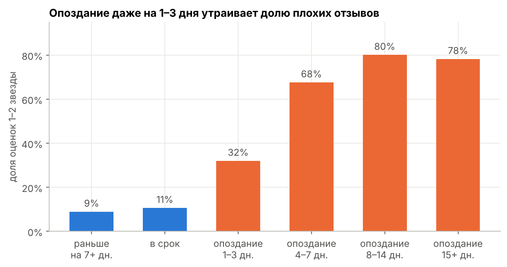
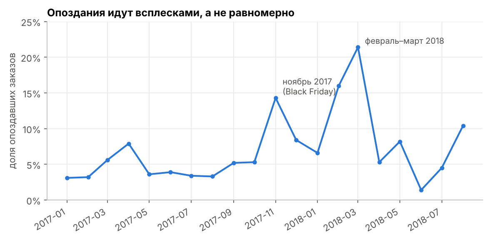
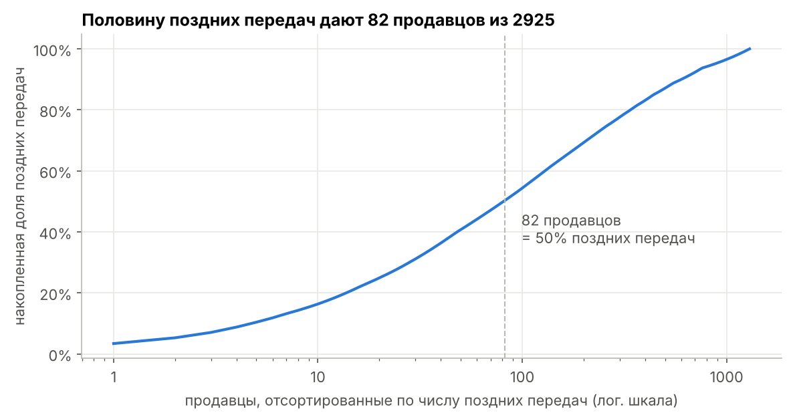
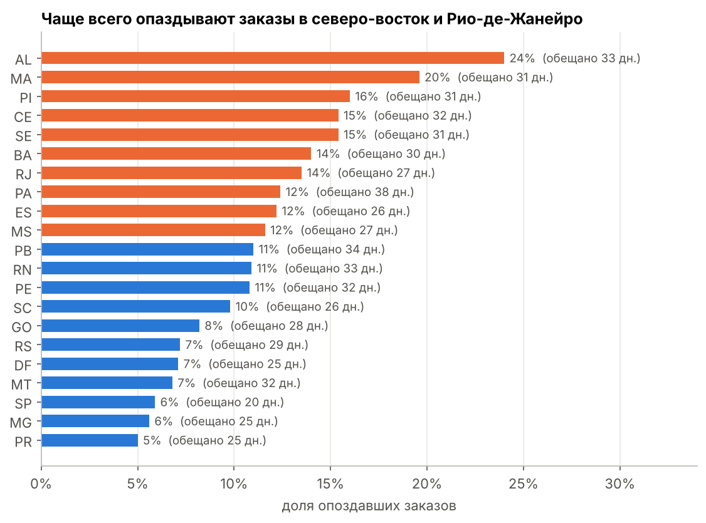

# Опоздания доставки на маркетплейсе Olist

Разбирал, насколько опоздания доставки влияют на оценки покупателей и где эти опоздания возникают. Данные — открытый датасет бразильского маркетплейса [Olist](https://github.com/olist/work-at-olist-data): ~96 тыс. доставленных заказов за 2017–2018 годы.

Инструменты: SQL (DuckDB), Python (pandas, matplotlib, scipy), Jupyter.

## Главное

**Опоздавших заказов всего 8%, но на них приходится треть всех плохих отзывов.** Если заказ пришёл в срок, оценку 1–2 ставят около 10% покупателей. При опоздании на 1–3 дня — уже 32%, больше недели — около 80%.



**Опоздания идут всплесками.** В обычный месяц опаздывает 3–6% заказов, в ноябре 2017 (Black Friday) — 14%, в феврале–марте 2018 — 16–21%. Причину второго всплеска по этим данным определить нельзя.



**Часть проблемы — на стороне продавцов, и она сосредоточена.** Если продавец передал заказ в доставку позже срока, заказ опаздывает к покупателю в 25% случаев против 6.5%. Половину таких поздних передач дают 82 продавца из 2925 — у них это случается в 2,3 раза чаще, чем у остальных.



**Сроки для регионов рассчитаны неравномерно.** В северо-восточных штатах и Рио-де-Жанейро опаздывает 14–24% заказов, в Сан-Паулу и на юге — 5–7%. При этом в дальние северные штаты заказы опаздывают редко: там изначально обещают 40–47 дней.



**Повторные покупки.** После опоздавшего первого заказа возвращается 3,2% покупателей против 4,0% (p < 0.01). Эффект есть, но небольшой — повторных покупок на площадке мало в принципе.

## Что я бы предложил

- Отдельно работать с продавцами, которые чаще всего задерживают передачу в доставку: это короткий список, а не размазанная по всем проблема.
- Пересчитать обещанные сроки для штатов, где опаздывает больше 12% заказов. Срок на пару дней длиннее, скорее всего, лучше, чем опоздание.
- Перед распродажами заранее увеличивать обещанный срок.

## Ограничения

Это наблюдательные данные, а не эксперимент. Часть связи «опоздание → плохой отзыв» может объясняться тем, что плохие продавцы и опаздывают, и, например, отправляют не тот товар. Данных о перевозчиках, погоде и праздниках в датасете нет, поэтому причины всплесков остаются гипотезами.

## Структура

```
sql/
  01_orders_flat.sql          сборка таблицы заказов из 5 исходных таблиц
  02_delay_vs_review.sql      оценка в зависимости от опоздания
  03_late_by_month.sql        доля опозданий по месяцам
  04_seller_concentration.sql концентрация поздних передач у продавцов
  05_states.sql               опоздания по штатам
  06_repeat_purchase.sql      повторные покупки после опоздания
notebooks/
  analysis.ipynb              весь анализ с комментариями
images/                       графики
download_data.py              скачивание данных
```

## Как запустить

```bash
pip install -r requirements.txt
python download_data.py
jupyter notebook notebooks/analysis.ipynb
```
